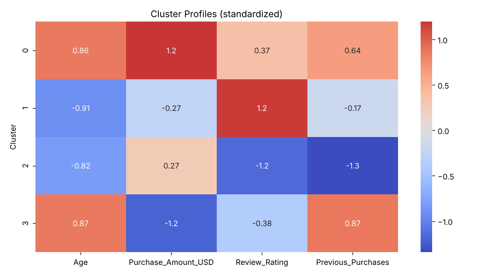
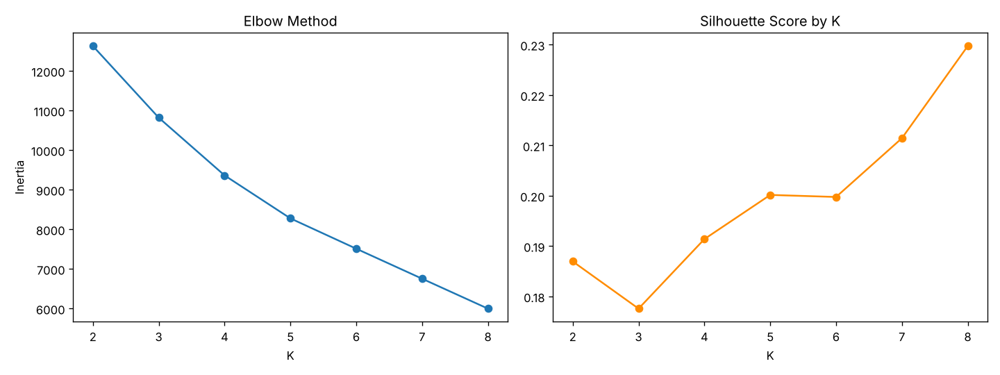
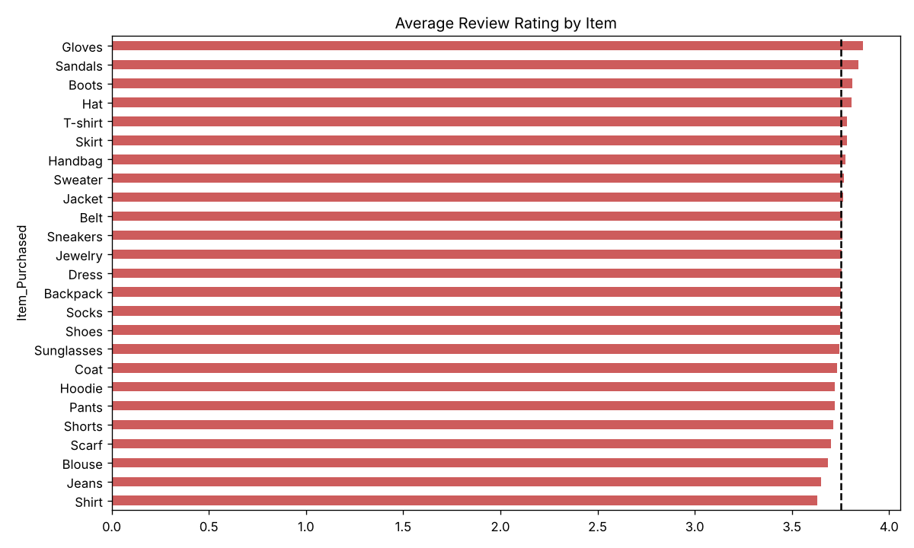

# Customer Segmentation Analysis

Customer segmentation and spending analysis on a retail shopping dataset (3,900 customers) using **Python, Pandas, Seaborn and K-Means clustering**. The project answers three business questions: where discounts should go, how card spending varies by age, season and location, and which customer groups exist and how to market to each.

## Dataset
- **Shopping Trends dataset**: 3,900 records, 19 columns (Age, Gender, Item, Category, Purchase Amount, Location, Season, Review Rating, Payment Method, Previous Purchases, Frequency of Purchases, etc.)
- Data quality check: no missing values and no duplicate rows

## Tools
Python · Pandas · NumPy · Matplotlib · Seaborn · Scikit-learn · Jupyter Notebook

## Approach
1. Data loading and quality checks
2. **Task 1:** Discount targeting using category-level and item-level review ratings and discount rates
3. **Task 2:** Credit vs. debit card spending by age group, plus the effect of season and location
4. **Segmentation:** K-Means on standardized Age, Purchase Amount, Review Rating and Previous Purchases. K was chosen using the Elbow method and Silhouette score (K = 2–8); K = 4 was selected for stable, actionable segments
5. Cluster profiling and a marketing campaign for each segment

## Key Insights

### Discounts
- The four broad categories (Clothing, Accessories, Footwear, Outerwear) are nearly identical in rating, spend and discount rate, so category alone is not useful for targeting.
- At item level, **Shirt, Jeans, Blouse, Scarf, Shorts and Pants** have the lowest ratings (about 3.63–3.72) and are the best discount candidates.
- Top-rated items (Gloves, Sandals, Boots, Hat) do not need discounts, so margin can be protected there.

### Card spending
- Average spend is flat across age groups (about $59–61), but **credit card users out-spend debit card users in every age band**.
- **Fall ($61.56) and Winter ($60.36)** have the highest spend and card usage.
- Top states by average spend: Alaska, Pennsylvania and Arizona (about $66–68). The gap between the highest and lowest states is roughly 25%.

### Customer segments (K = 4)

| Cluster | Profile | Recommended campaign |
|---|---|---|
| 0 | Older (~56), high spend ($82), rating 3.96 | VIP / loyalty programme, early access to premium items |
| 1 | Younger (~31), moderate spend ($55), highest rating (4.43) | Referral and advocacy, subscription upsell |
| 2 | Younger (~33), spend $65, lowest rating (3.09) | Retention and win-back, service recovery, targeted discounts |
| 3 | Older (~56), lowest spend ($38), rating 3.54 | Value campaign, free-shipping thresholds, bundle deals |

**Note:** Silhouette scores are modest (0.18–0.23), which suggests the data has no strongly separated natural clusters. K = 4 was chosen for practical, actionable segments.

## Visuals





## Repository Contents
- `CDACL-002_Customer_Segmentation.ipynb`: full analysis notebook
- `shopping_table.csv`: dataset
- `requirements.txt`: Python dependencies
- `images/`: charts used in this README
- `Customer_Segmentation_Analysis_Report_Srikanth_Final.docx`: written report
- `Customer_Segmentation_Analysis_Srikanth_Corrected.pptx`: presentation

## How to Run
```bash
pip install -r requirements.txt
jupyter notebook CDACL-002_Customer_Segmentation.ipynb
```

## Author
**Srikanth Jadi**, Aspiring Data Analyst · Hyderabad, India
[LinkedIn](https://www.linkedin.com/in/srikanth-jadi-0392b4415) · [GitHub](https://github.com/jadisrikanth123-prog)
